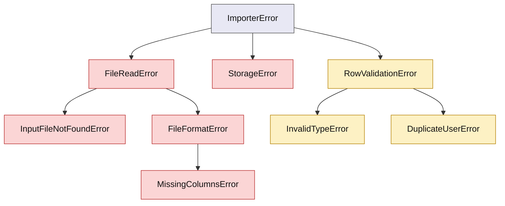

# Resilient Data Importer CLI

A command-line tool that imports user data from a CSV file into a JSON file (the simulated database). It handles missing files, malformed rows and duplicate users without crashing, and logs what it does.

**Demo video:** [Watch on Loom](https://www.loom.com/share/1b8cb4e0a1c54290851abf189844fae7)

## Requirements

- Python 3.11 or newer
- [Poetry](https://python-poetry.org/) for dependencies

## Setup

```powershell
poetry install
poetry run pre-commit install
```

`requirements.txt` is also provided for pip users. It lists the development tools, since the app itself uses only the standard library.

## Run

```powershell
poetry run python -m resilient_data_importer_cli.main
```

The tool greets you, asks for the path to a CSV file, imports it, prints a summary and says goodbye. Try the files in `samples/`:

| File | What it shows |
|---|---|
| `samples/good_users.csv` | A clean import |
| `samples/extra_users.csv` | Extra columns (`phone`, `city`, `age`) kept in the output |
| `samples/messy_users.csv` | A duplicate id and a bad id, both skipped with a warning |

Output is written as JSON into the `output/` folder. Logs go to `importer.log`, and warnings also appear on the console.

## CSV format

| Column | Required | Notes |
|---|---|---|
| `name` | Yes | Header names are case-insensitive and spaces are ignored |
| `email` | Yes | |
| `user_id` | No | Must be a positive whole number when present |
| Any other column | No | Kept as text in the `extra` field |

## Design decisions

- `name` and `email` are required columns, and `user_id` is optional.
- Extra columns are kept in an `extra` dictionary and written to the JSON.
- Empty cells are kept as empty values.
- A row with an invalid `user_id` (for example `7.5` or `abc`) is skipped and logged as a warning.
- A duplicate is skipped and logged as a warning. Two users are duplicates when they share a `user_id`. Without an id, every field must match.
- Problems with the file itself (missing file, empty file, missing columns, unwritable output) stop the import, print the reason and exit with code 1.

## Exceptions



Red: the import stops. Yellow: the row is skipped and a warning is logged.

| Exception | Raised when | Behavior |
|---|---|---|
| `InputFileNotFoundError` | The CSV path does not exist | Stop |
| `FileReadError` | The file cannot be opened | Stop |
| `FileFormatError` | The file is empty or not valid CSV | Stop |
| `MissingColumnsError` | `name` or `email` is missing from the header | Stop |
| `StorageError` | The JSON file cannot be written | Stop |
| `InvalidTypeError` | `user_id` is not a positive whole number, or a value is missing from the row | Skip the row |
| `DuplicateUserError` | The user is already stored | Skip the row |

## Project structure

```
src/resilient_data_importer_cli/
    exceptions.py   custom exception hierarchy
    models.py       the User dataclass
    reader.py       opens the CSV and yields rows
    validator.py    converts a row into a User
    storage.py      repository that writes users to JSON
    importer.py     the import loop and duplicate check
    cli.py          prompts and messages
    main.py         logging setup and entry point
tests/              pytest suite
samples/            example CSV files
```

## Code quality

```powershell
poetry run black --check src tests
poetry run ruff check src tests
poetry run mypy src
```

These run automatically on every commit through pre-commit (Black, Ruff and mypy).

## Tests

```powershell
poetry run pytest --cov=resilient_data_importer_cli --cov-report=term-missing
```

The suite uses fixtures for temporary CSV files, `parametrize` for the validator and `pytest-mock` for the storage layer. Coverage is 99%. The report is saved in `coverage.txt`.

## Git workflow

Git Flow: `main` holds stable releases, `develop` collects finished features, and each feature lives on its own `feature/...` branch and is merged into `develop` through a pull request.
